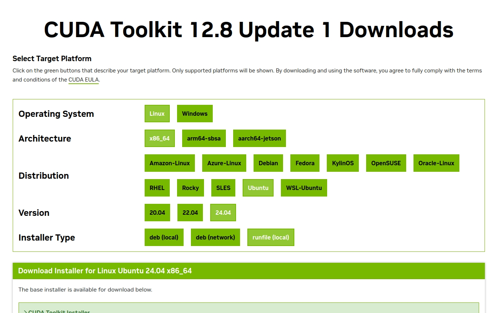
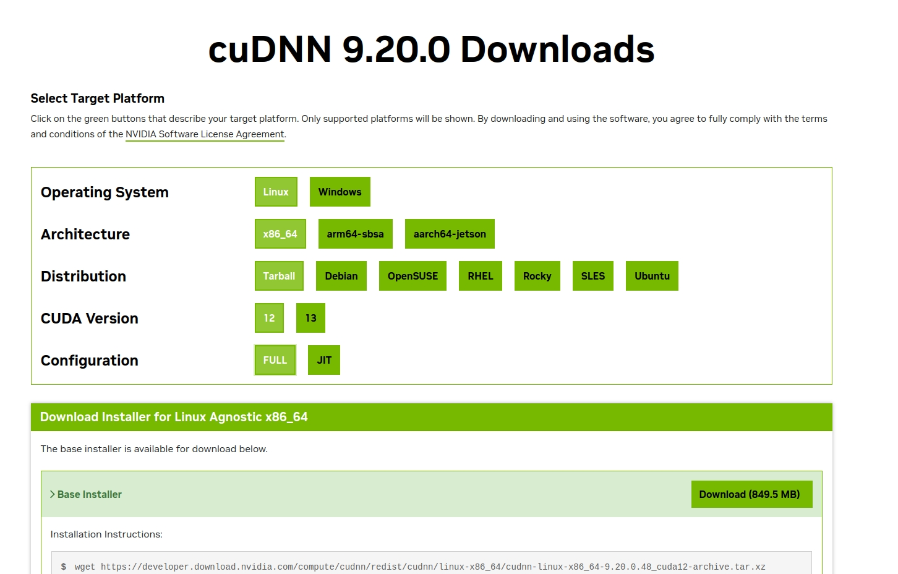
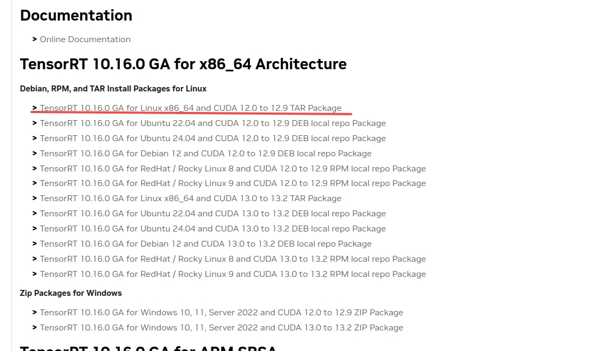

# GrabGen-位姿生成与抓取

本文通过SAM3与位姿生成工具，实现了任意物体的识别、分割、位姿生成与抓取。

## 仓库

- GraspGen:[https://github.com/vanstrong12138/GraspGen](https://github.com/vanstrong12138/GraspGen)
- Agilex-Collge:[https://github.com/agilexrobotics/Agilex-College/tree/master](https://github.com/agilexrobotics/Agilex-College/tree/master)

## 硬件要求

- x86桌面平台
- 显存不少于16G的英伟达显卡
- realsense

### 项目部署平台

- Ubuntu24.04
- ROS jazzy
- RTX 5090
- NVIDIA Driver Version  570.195.03
- CUDA Version  12.8

1. 安装NVIDIA显卡驱动
```bash
sudo apt update
sudo apt upgrade
sudo add-apt-repository ppa:graphics-drivers/ppa
sudo apt update
sudo apt install nvidia-driver-570
#重启
reboot
```

1. 安装CUDA Toolkit 12.8

-   先前往[NVIDIA官网](https://developer.nvidia.com/cuda-12-8-1-download-archive?target_os=Linux&target_arch=x86_64&Distribution=Ubuntu&target_version=24.04&target_type=runfile_local)下载CUDA的runfile文件


- 执行安装命令
```bash
wget https://developer.download.nvidia.com/compute/cuda/12.8.1/local_installers/cuda_12.8.1_570.124.06_linux.run
sudo sh cuda_12.8.1_570.124.06_linux.run
```
-   安装时取消勾选第一项driver，因为我们第一步已经安装过显卡驱动了

3. 添加环境变量
```bash
echo 'export PATH=/usr/local/cuda-12.8/bin:$PATH' >> ~/.bashrc
echo 'export LD_LIBRARY_PATH=/usr/local/cuda-12.8/lib64:$LD_LIBRARY_PATH' >> ~/.bashrc
source ~/.bashrc
```

4. 安装后可以执行nvcc -V查看CUDA信息
```bash
nvcc -V
```

5. 安装cuDnn
-   去[NVIDIA官网](https://developer.nvidia.com/cudnn-downloads?target_os=Linux&target_arch=x86_64&Distribution=Agnostic&cuda_version=12&Configuration=Full)下载cuDnn的tar文件，解压后对文件进行拷贝


-     解压后执行下面的命令把cuDNN拷贝到CUDA的安装目录下
```bash
sudo cp cuda/include/cudnn*.h /usr/local/cuda/include
sudo cp cuda/lib/libcudnn* /usr/local/cuda/lib64
sudo chmod a+r /usr/local/cuda/include/cudnn*.h /usr/local/cuda/lib64/libcudnn*
```

1. 安装TensorRT，去[NVIDIA官网](https://developer.nvidia.com/nvidia-tensorrt-8x-download)下载TensorRT的tar文件，解压后对文件进行拷贝


-   解压后执行下面的命令把TensorRT拷贝到/usr/local目录下

```bash
#解压
tar -xvf TensorRT-10.16.0.72.Linux.x86_64-gnu.cuda-12.9.tar.gz 

#进入TensorRT-10.16.0.72.Linux.x86_64-gnu.cuda-12.9
cd TensorRT-10.16.0.72.Linux.x86_64-gnu.cuda-12.9/

#拷贝到/usr/local目录下
sudo mv TensorRT-10.16.0.72/ /usr/local/
```

- 测试TensorRT是否安装成功
```bash
#进入MNIST手写数字识别的目录下
cd /usr/local/TensorRT-10.16.0.72/samples/sampleOnnxMNIST

#编译
make

#在/usr/local/TensorRT-10.16.0.72/bin找到可执行文件sample_onnx_mnist
cd /usr/local/TensorRT-10.16.0.72/bin
./sample_onnx_mnist
```

### SAM3部署

- Python 3.12 or higher
- PyTorch 2.7 or higher
- CUDA-compatible GPU with CUDA 12.6 or higher

1. 创建conda虚拟环境
```bash
conda create -n sam3 python=3.12
conda deactivate
conda activate sam3
```

2. 安装与cuda版本兼容的pytorch
```bash
# 50系列显卡推荐用cuda12.8 torch2.8
# CUDA 12.8
# numpy建议降级到<1.23
pip install torch==2.8.0 torchvision==0.23.0 torchaudio==2.8.0 --index-url https://download.pytorch.org/whl/cu128

cd sam3

pip install -e .

```

2. 模型下载
   1. 提交表格获取HugginFace模型下载资格[https://huggingface.co/facebook/sam3](https://huggingface.co/facebook/sam3)
   2. 国内镜像站搜索

### 机械臂驱动部署
项目发布的是target_pose末端位姿，可以手动修改为其他机械臂

1. 以PiPER机械臂为例
```bash
pip install python-can

git clone https://github.com/agilexrobotics/pyAgxArm.git

cd pyAgxArm
pip install .
```

## 克隆

- 克隆此项目到本地

```bash
cd YOUR_PATH

git clone -b ros2_jazzy_version https://github.com/AgilexRobotics/GraspGen.git
```

## 运行

1. 抓取节点
```bash
python YOUR_PATH/sam3/realsense-sam.py --prompt "目标物体英文名称"
```

2. 执行抓取任务

``` plaintext
A=主臂零力  D=普通模式+记录位姿  S=回零  X=复现位姿  Q=夹爪开  E=夹爪合  p=点云/抓取  t=改提示词  g=下发抓取  Esc=退出
```

3. 自动抓取任务
```bash
python YOUR_PATH/sam3/realsense-sam.py --prompt "目标物体英文名称" --auto
```

